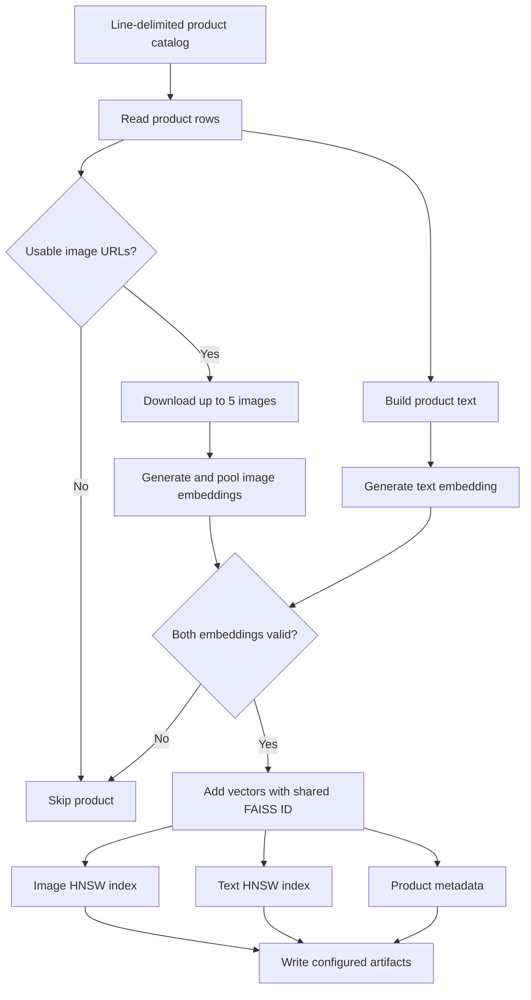
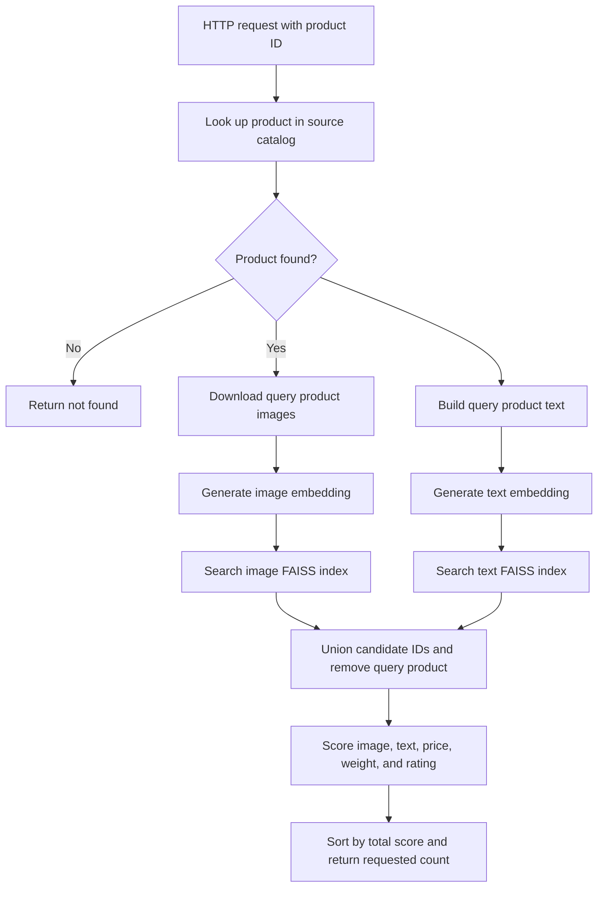

# Fashion Product Recommendation API

This project builds image and text similarity indexes for an Amazon fashion product catalog, then serves similar-product recommendations through a FastAPI application. Recommendations combine image similarity, text similarity, price, weight, and rating.

## Project Files

| File | Purpose |
| --- | --- |
| `app.py` | FastAPI application. Loads the search engine at startup and exposes health, recommendation, and product-detail endpoints. |
| `config.py` | Shared paths and settings, including the source catalog, active index/metadata files, FashionCLIP model, ranking weights, and candidate limits. |
| `sim_search.py` | Runtime search engine. Loads FAISS indexes and metadata, embeds query products, retrieves image/text candidates, scores them, and formats recommendations. |
| `gen_embv2.py` | Current batch-indexing pipeline. Embeds up to five product images plus product text, writes two FAISS indexes, and writes enriched metadata. |
| `gen_emd.py` | Earlier batch-indexing implementation. Uses one selected image and a shorter text description; it writes to the paths configured in `config.py`, so running it replaces the active artifacts. |
| `utils.py` | Shared helpers for numeric conversion, weight normalization, proximity scoring, and extraction of valid image URLs. |
| `requirements.txt` | Python dependencies for the API, model inference, image handling, data processing, and FAISS search. |
| `Dockerfile` | Multi-stage Docker build for the API. Installs dependencies, copies application and index assets, and runs Uvicorn on port `8000`. |
| `marketing_sample_for_amazon_com-amazon_fashion_products__20200201_20200430__30k_data.ldjson` | Source product catalog in line-delimited JSON format. It supplies product details and image URLs used during indexing and query-time embedding. |
| `image_hnsw_all.bin` | Active FAISS HNSW image-vector index, configured by `config.py`. |
| `text_hnsw_all.bin` | Active FAISS HNSW text-vector index, configured by `config.py`. |
| `product_metadata_all.json` | Active mapping from FAISS IDs to product identifiers, attributes, search text, and image URLs. Must correspond to the active index files. |
| `image_hnsw.bin`, `text_hnsw.bin` | Additional index snapshots not selected by the current configuration. |
| `image_hnsw_50.bin`, `text_hnsw_50.bin` | Additional index snapshots not selected by the current configuration. |
| `product_metadata.json`, `product_metadata_50.json` | Additional metadata snapshots not selected by the current configuration. Keep each metadata snapshot paired with the indexes from the same indexing run. |

`__pycache__/` contains Python-generated bytecode cache files and is not required to run the application.

## Indexing Flow

Run `gen_embv2.py` to build the artifacts selected by the current configuration. The pipeline skips products without usable images or whose embeddings fail. Image and text vectors are normalized and stored in separate HNSW indexes; metadata records the shared FAISS ID for each indexed product.



## Query Flow

Each recommendation request looks up its product in the source catalog and generates fresh FashionCLIP image and text embeddings. FAISS retrieves up to `DEFAULT_CANDIDATE_POOL` candidates independently for each modality; candidates are unioned and ranked using the weights in `config.py`. The query product is excluded from results if it is indexed. A product must exist in the source catalog, but it does not have to be present in the FAISS indexes.



The current ranking weights are image `0.40`, text `0.20`, price `0.20`, weight `0.10`, and rating `0.10`. Missing numeric attributes receive a neutral proximity score of `0.5`; a candidate absent from one modality's retrieval list receives `0.0` for that modality.

## Run Locally

Use Python 3.10 or compatible with the installed dependencies. From the project directory:

```powershell
python -m venv .venv
.venv\Scripts\Activate.ps1
python -m pip install -r requirements.txt
python gen_embv2.py
uvicorn app:app --host 0.0.0.0 --port 8000
```

Index generation downloads the FashionCLIP model and product images, so the first run needs network access and can take a while. The API also loads the model on startup. Set `MODEL_ID`, data paths, and artifact paths in `config.py` as needed. The configured artifact files must all exist and their counts must match, or startup fails.

## API

- `GET /health` returns service status and the number of indexed products.
- `GET /recommend?product_id=<id>&num_items=5` returns ranked recommendations and score details. `num_items` accepts 1 through 50.
- `GET /find_similar_products?product_id=<id>&num_similar=5` returns only the recommended product IDs.
- `GET /products/<product_id>` returns source-catalog product details without running similarity search.

FastAPI's interactive API documentation is available at `/docs` while the service is running.

## Docker Note

The checked-in `Dockerfile` dataset `COPY` pattern currently ends in `.ljson`, while the catalog in this project ends in `.ldjson`. Update that pattern to match the actual catalog filename (or use an explicit filename) before building the Docker image.