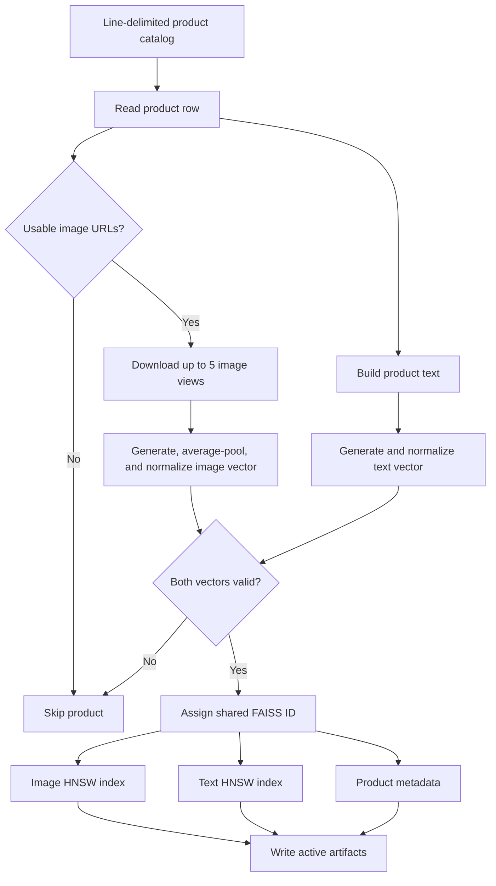
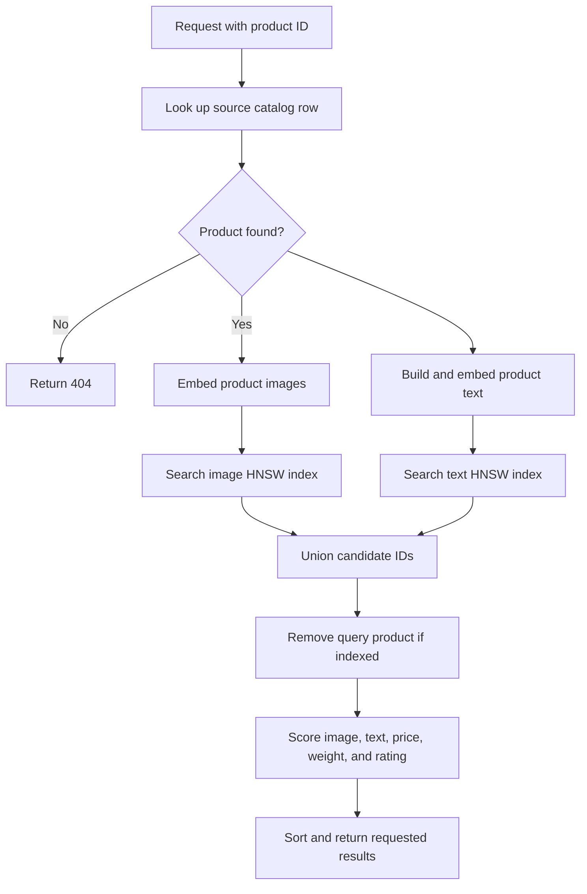

# Fashion Product Similarity API

This project implements the SAP CXII technical exercise: given a product's `uniq_id`, return similar fashion products from the provided Amazon catalog. It combines FashionCLIP image and text embeddings with price, weight, and rating similarity, retrieves approximate neighbors with FAISS, and serves results through FastAPI.

## Features

- Multimodal retrieval from separate image and text FAISS HNSW indexes.
- Hybrid ranking using visual, semantic, price, weight, and rating similarity.
- API endpoints for product recommendations, product details, and health status.
- Batch index generation with shared IDs across both indexes and product metadata.
- Docker image runs the API as a non-root user.

## Architecture

### Indexing

Run `gen_embv2.py` to generate the active artifacts configured in `config.py`. Products without usable image URLs or with failed embeddings are skipped. The image and text vectors for each indexed product use the same FAISS ID.



### Recommendation Query

The requested product must exist in the source catalog. It does not have to be indexed, but it must have at least one downloadable image to generate the required image embedding.



## Project Files

| File or asset | Purpose |
| --- | --- |
| `app.py` | FastAPI app, startup loading, endpoints, parameter validation, and HTTP error handling. |
| `config.py` | Dataset and artifact paths, model ID, ranking weights, similarity scales, and result limits. |
| `sim_search.py` | Loads the catalog, model, indexes, and metadata; creates query embeddings; retrieves and ranks candidates. |
| `gen_embv2.py` | Current multi-image batch embedding and FAISS indexing pipeline. |
| `utils.py` | Numeric parsing, weight normalization, proximity scoring, and image URL helpers. |
| `requirements.txt` | Python dependencies. |
| `Dockerfile` | Multi-stage API image. Installs CPU PyTorch dependencies, configures the Hugging Face cache, and runs Uvicorn on port `9000`. |
| `marketing_sample_for_amazon_com-amazon_fashion_products__20200201_20200430__30k_data.ldjson` | Source line-delimited JSON catalog used at indexing time and for request-time product lookup. |
| `image_hnsw_all.bin`, `text_hnsw_all.bin` | Active image and text FAISS indexes selected by `config.py`. |
| `product_metadata_all.json` | Metadata keyed by FAISS ID; must match the two active indexes. |
## Prerequisites

- Python 3.10 or a compatible version for local execution.
- The source catalog and the three active index/metadata artifacts listed above.
- Internet access on first use to download FashionCLIP and, during indexing or recommendations, product images.
- Docker Desktop for container builds and runs.

## Build the Indexes

The checked-in configuration points to the `_all` artifacts. Regenerate those files when the source catalog, embedding process, or model changes:

```powershell
python gen_embv2.py
```

This command can take a while because it downloads the model and product images. It overwrites the active index and metadata files. Keep the image index, text index, and metadata from the same run together.

## Run Locally

From the project directory in PowerShell:

```powershell
py -3.10 -m venv .venv
.venv\Scripts\Activate.ps1
python -m pip install -r requirements.txt
uvicorn app:app --host 0.0.0.0 --port 8000
```

Run `python gen_embv2.py` first if the configured index artifacts are missing or need to be rebuilt. The API loads the model and index assets during startup. Local Uvicorn listens on port `8000`.

## Run with Docker

Build the image from the project directory and run it with container port `9000` mapped to host port `9000`:

```powershell
docker build -t fashion-recommender:latest .
docker run --rm -p 9000:9000 fashion-recommender:latest
```

The container uses a writable Hugging Face cache at `/home/appuser/.cache/huggingface`. The model is downloaded when the API starts, so the first startup requires internet access. To retain downloaded model files after removing the container, mount a named volume:

```powershell
docker run --rm -p 9000:9000 `
  -v fashion-hf-cache:/home/appuser/.cache/huggingface `
  fashion-recommender:latest
```

The source catalog and active indexes are copied into the image; index generation is not run inside the API container. No Kubernetes manifests are included in this repository.

## API Reference

FastAPI's interactive documentation is available at `http://localhost:8000/docs` locally or `http://localhost:9000/docs` when using Docker.

### `GET /find_similar_products`

Required query parameter: `product_id` (catalog `uniq_id`). Optional `num_similar` defaults to `5` and accepts values from `1` to `50`. Returns a JSON array of product IDs.

```text
GET http://localhost:9000/find_similar_products?product_id=<uniq_id>&num_similar=5
```

### `GET /recommend`

Accepts `product_id` and optional `num_items` (default `5`, maximum `50`). Returns the searched ID, counts, ranked recommendation details, score breakdowns, image URLs, and selected attributes.

```text
GET http://localhost:9000/recommend?product_id=<uniq_id>&num_items=5
```

### `GET /products/{product_id}`

Returns source-catalog details for one product without running similarity search.

### `GET /health`

Returns service status and the number of indexed products.

Unknown product IDs return `404`. Invalid query parameters are rejected by FastAPI. The similar-products endpoint returns `422` if query embeddings cannot be created and `500` for unexpected recommendation failures.

## Configuration and Ranking

Update `config.py` to change the model, dataset or artifact paths, ranking weights, scales, and retrieval limits.

| Component | Weight | Similarity behavior |
| --- | ---: | --- |
| Image | `0.40` | FashionCLIP image-vector cosine similarity. |
| Text | `0.20` | FashionCLIP text-vector cosine similarity over product name, brand, color, category, and keywords. |
| Price | `0.20` | Exponential proximity with a scale of `50`. |
| Weight | `0.10` | Weight is normalized to grams; exponential proximity scale is `100`. |
| Rating | `0.10` | Exponential proximity scale is `1`. |

FAISS inner-product scores for normalized embeddings are mapped from `[-1, 1]` to `[0, 1]`. Numeric proximity is `exp(-abs(value_a - value_b) / scale)`. Missing numeric values receive `0.5`; a candidate not retrieved by one modality receives `0.0` for that modality. The default candidate depth is `150` per modality, and HNSW `efSearch` is `50`.